# KIẾN TRÚC THIẾT KẾ PHẦN MỀM: DHOPM EXTENSIBLE STREAM MINING FRAMEWORK
**Đồ Án Môn Học: Mẫu Thiết Kế (Design Patterns) - Khoa CNTT, Đại Học Đà Lạt**  
**Nhóm sinh viên thực hiện:** Võ Công Vinh (2312800) • Nguyễn Đức Tín (2312774) • Ngô Quốc Trường Vĩ (2312796)  
**Đề tài:** Tái cấu trúc & Mở rộng Bộ Khai Phá Mẫu Độ Chiếm Dụng Cao Suy Giảm Theo Thời Gian Thực (DHOPM - EAAI 2026) theo Chuẩn 23 GoF Design Patterns & Clean Architecture.

---

## 1. TỔNG QUAN KIẾN TRÚC (ARCHITECTURE OVERVIEW)

Dự án chuyển đổi mã nguồn thuật toán khoa học DHOPM thành một **Framework Khai phá Dữ liệu Luồng Đa Chiến Lược (Extensible Stream Mining Framework)**. Kiến trúc tuân thủ triệt để nguyên lý tách biệt mối quan tâm (Separation of Concerns), phân tầng rõ rệt giữa:
- **Tầng Giao Diện (Presentation Layer):** JavaFX Controller & UI Components hoàn toàn mỏng (Thin Controller), không chứa logic thuật toán hay quản lý luồng.
- **Tầng Bao Đóng & Điều Phối (Facade & Orchestration Layer):** Điểm truy cập duy nhất điều phối luồng thực thi, ngăn xếp lệnh hoàn tác và quản lý trạng thái máy.
- **Tầng Thuật Toán & Xử Lý Luồng (Core Algorithm & Mining Engine):** Cung cấp khung xương giải thuật chuẩn hóa, cho phép mở rộng các chiến lược suy giảm và cắt tỉa mà không xâm phạm mã nguồn hiện hữu.
- **Tầng Mô Hình Dữ Liệu & Ảnh Chụp (Model & Snapshot Layer):** Cấu trúc tóm lược một lần quét (One-scan DHO-List) tích hợp khả năng chụp ảnh trạng thái phục vụ hoàn tác.

---

## 2. HỆ THỐNG CÁC DESIGN PATTERNS GOF ĐÃ TRIỂN KHAI

Hệ thống hiện thực hóa **10 Mẫu Thiết Kế GoF** thuộc cả 3 nhóm chính:

```
                                  ┌────────────────────────┐
                                  │   JavaFX UI Controller │
                                  └───────────┬────────────┘
                                              │ Calls
                                              ▼
┌────────────────────────────────────────────────────────────────────────────────────────┐
│ [FACADE PATTERN] StreamMiningFacade                                                    │
│  - Che giấu đa luồng, bộ đệm commands, pipeline decorators và state context            │
└───────┬──────────────────────┬──────────────────────┬──────────────────────┬───────────┘
        │                      │                      │                      │
        ▼                      ▼                      ▼                      ▼
┌──────────────┐       ┌──────────────┐       ┌──────────────┐       ┌──────────────┐
│[STATE PATTERN│       │ [COMMAND &   │       │ [DECORATOR   │       │ [OBSERVER    │
│ StreamState  │       │  MEMENTO]    │       │  PATTERN]    │       │  PATTERN]    │
│ - IdleState  │       │StreamCommand │       │StreamMiner   │       │StreamObserver│
│ - Running    │       │- StepNextCmd │       │- Benchmark   │       │MiningObserver│
│ - Paused     │       │- InjectBatch │       │- Logging     │       │- AuditLog    │
│ - Completed  │       │DHOListMemento│       │DefaultMiner  │       │- Benchmark   │
└──────────────┘       └──────────────┘       └───────┬──────┘       └──────────────┘
                                                      │ Extends
                                                      ▼
                                       ┌─────────────────────────────┐
                                       │ [TEMPLATE METHOD PATTERN]   │
                                       │ AbstractStreamMiner         │
                                       │ 1. validateBatch            │
                                       │ 2. updateStructure          │
                                       │ 3. calculateBounds          │
                                       │ 4. minePatterns (DFS)       │
                                       │ 5. notifyObservers          │
                                       └──────────────┬──────────────┘
                                                      │ Uses
                       ┌──────────────────────────────┴──────────────────────────────┐
                       ▼                                                             ▼
        ┌─────────────────────────────┐                               ┌─────────────────────────────┐
        │ [STRATEGY PATTERN: DECAY]   │                               │ [STRATEGY PATTERN: PRUNING] │
        │ DecayStrategy               │                               │ PruningStrategy             │
        │ - DampedExponentialDecay    │                               │ - DUBOPruningStrategy       │
        │ - LandmarkDecay             │                               │ - NoPruningStrategy         │
        │ - LinearDecay               │                               └─────────────────────────────┘
        └─────────────────────────────┘
```

---

### 2.1. Nhóm Hành Vi (Behavioral Patterns)

#### 1. Strategy Pattern (Chiến Lược)
- **Vị trí:** Package `vn.edu.dlu.dhopm.pattern.strategy`
- **Các thành phần:**
  * Interface `DecayStrategy`: Họ giải thuật tính trọng số suy giảm theo thời gian \(w(tid, TL)\).
    - `DampedExponentialDecay`: Suy giảm hàm mũ \(f^{TL - tid}\) theo bài báo gốc DHOPM.
    - `LandmarkDecay`: Cửa sổ mốc không suy giảm (\(w=1.0\), tương đương \(f=1.0\)).
    - `LinearDecay`: Suy giảm tuyến tính \(\max(0.0, 1.0 - \lambda \cdot (TL - tid))\).
  * Interface `PruningStrategy`: Họ giải thuật cắt tỉa không gian tìm kiếm DFS.
    - `DUBOPruningStrategy`: Cắt tỉa nhánh bằng cận trên chặt \(\text{DUBO}(X) < minSup\).
    - `NoPruningStrategy`: Không cắt tỉa (Duyệt vét cạn làm đường cơ sở đo lường hiệu năng).
- **Lợi ích:** Đạt được tính đa hình động cao, người dùng có thể đổi mô hình suy giảm trên giao diện ngay khi stream đang chạy mà không cần khởi động lại ứng dụng.

#### 2. Template Method Pattern (Phương Thức Mẫu)
- **Vị trí:** Package `vn.edu.dlu.dhopm.pattern.template`
- **Các thành phần:**
  * Lớp trừu tượng `AbstractStreamMiner`: Định nghĩa phương thức mẫu `final processBatchAndMine(...)` với khung xương 5 bước chuẩn mực:
    1. `validateBatch(batch)`: Kiểm tra tính toàn vẹn của dữ liệu giao dịch.
    2. `updateStructure(batch)`: Cập nhật cấu trúc tóm lược Global DHO-List (One-scan).
    3. `calculateBounds(config)`: Tái cấu trúc trọng số suy giảm và sắp xếp thứ tự cận trên.
    4. `minePatterns(config)`: Khai phá DFS Pattern Growth kết hợp cắt tỉa.
    5. `notifyObservers(result)`: Báo cáo kết quả chu kỳ khai phá cho các bên quan sát.
  * Lớp con `DefaultStreamMiner`: Hiện thực chi tiết 5 bước này.
- **Lợi ích:** Đảm bảo toàn bộ quy trình khoa học được thực thi đúng thứ tự bất biến, các nhà phát triển sau này có thể kế thừa và thay đổi từng bước mà không làm vỡ kiến trúc tổng thể.

#### 3. Command Pattern kết hợp Memento Pattern (Lệnh & Ảnh Chụp)
- **Vị trí:** Package `vn.edu.dlu.dhopm.pattern.command` & `vn.edu.dlu.dhopm.pattern.memento`
- **Các thành phần:**
  * Interface `StreamCommand`: Đóng gói hành vi thực thi (`execute()`) và hoàn tác (`undo()`).
  * `StepNextCommand`: Bơm 1 giao dịch tiếp theo, lưu snapshot trạng thái trước khi bơm.
  * `InjectBatchCommand`: Bơm một lô giao dịch tùy biến vào hệ thống, hỗ trợ Undo.
  * `ResetCommand`: Khôi phục lại trạng thái ban đầu, hỗ trợ Undo nếu bấm nhầm.
  * `CommandManager`: Quản lý ngăn xếp `undoStack` và `redoStack`.
  * `DHOListMemento`: Đối tượng lưu trữ bản sao sâu (Deep copy snapshot) của `DHOList`, `currentTL`, và danh sách giao dịch.
- **Lợi ích:** Hiện thực hóa tính năng **Undo / Step-Back (Lùi lại giao dịch trước)** trực quan trên giao diện người dùng, giúp giảng viên và người xem dễ dàng quan sát sự biến động của DHO-List qua từng bước giao dịch.

#### 4. State Pattern (Trạng Thái)
- **Vị trí:** Package `vn.edu.dlu.dhopm.pattern.state`
- **Các thành phần:**
  * Interface `StreamState`: Định nghĩa hành vi phụ thuộc trạng thái (`start`, `pause`, `step`, `reset`).
  * `IdleState`: Hệ thống sẵn sàng (Cho phép Start, Step, Reset; khóa Pause).
  * `RunningState`: Luồng đang tự động chạy ngầm (Khóa Start, Step, Reset; cho phép Pause).
  * `PausedState`: Luồng tạm dừng (Cho phép Resume, Step, Reset; khóa Pause).
  * `CompletedState`: Đã xử lý hết giao dịch trong hàng đợi (Khóa Start, Pause, Step; cho phép Reset).
- **Lợi ích:** Xóa bỏ hoàn toàn các cờ logic (`boolean isRunning`) và các câu lệnh `if-else` phức tạp trong Controller, đảm bảo an toàn tương tranh và kiểm soát nút bấm tự động.

#### 5. Observer Pattern (Quan Sát Viên)
- **Vị trí:** Package `vn.edu.dlu.dhopm.pattern.observer`
- **Các thành phần:**
  * Interface `StreamObserver`: Lắng nghe sự kiện lô giao dịch mới cập bến.
  * Interface `MiningObserver`: Lắng nghe sự kiện chu kỳ khai phá hoàn tất.
  * `AuditLogObserver`: Ghi nhật ký kiểm toán hệ thống thời gian thực với timestamp.
  * `BenchmarkMetricsObserver`: Thu thập thống kê hiệu năng (thời gian trung bình, tỷ lệ cắt tỉa).
- **Lợi ích:** Tách rời bộ phát luồng khỏi các module tiêu thụ, dễ dàng bổ sung thêm các giao diện đồ họa hoặc cơ chế xuất báo cáo mà không can thiệp vào tầng lõi.

---

### 2.2. Nhóm Cấu Trúc (Structural Patterns)

#### 6. Decorator Pattern (Trang Trí)
- **Vị trí:** Package `vn.edu.dlu.dhopm.pattern.decorator`
- **Các thành phần:**
  * Interface `StreamMiner`: Hợp đồng chung cho bộ khai phá.
  * `AbstractMinerDecorator`: Lớp trang trí cơ sở ủy quyền mặc định.
  * `BenchmarkMinerDecorator`: Bọc ngoài `StreamMiner` để đo đạc thời gian thực thi (nanoseconds/microseconds) và lượng RAM tiêu thụ thông qua `System.nanoTime()` và `Runtime`.
  * `LoggingMinerDecorator`: Bọc ngoài để ghi vết hoạt động và tỷ lệ cắt tỉa.
- **Lợi ích:** Tuân thủ triệt để SRP: Tách rời trách nhiệm đo lường số liệu ra khỏi thuật toán khai phá, có thể xếp chồng linh hoạt nhiều Decorator tại runtime.

#### 7. Facade Pattern (Mặt Tiền)
- **Vị trí:** Package `vn.edu.dlu.dhopm.pattern.facade`
- **Các thành phần:**
  * Lớp `StreamMiningFacade`: Điểm truy cập trung tâm duy nhất cho tầng UI Controller.
- **Lợi ích:** Giảm khớp nối (Loose Coupling). Giao diện người dùng không cần biết chi tiết về `ScheduledExecutorService`, `CommandManager`, `DHOListMemento`, `MiningConfig`, hay chuỗi `Decorator Pipeline`. Mọi thao tác gói gọn trong các hàm cấp cao: `facade.startStream()`, `facade.stepNext()`, `facade.undo()`, `facade.setDecayStrategy(...)`.

---

### 2.3. Nhóm Khởi Tạo (Creational Patterns)

#### 8. Builder Pattern (Xây Dựng)
- **Vị trí:** Package `vn.edu.dlu.dhopm.pattern.builder`
- **Các thành phần:**
  * Lớp `MiningConfig` và `MiningConfig.Builder`.
- **Lợi ích:** Thiết lập tham số một cách an toàn (Type-safe), hỗ trợ kiểm tra tính hợp lệ tại chỗ (Fail-fast validation: \(f \in (0, 1]\), \(minSup > 0\), \(period \ge 50ms\)), tạo đối tượng bất biến (Immutable), tránh lỗi Telescoping Constructor.

#### 9. Factory Method Pattern (Phương Thức Nhà Máy)
- **Vị trí:** Package `vn.edu.dlu.dhopm.pattern.factory`
- **Các thành phần:**
  * Abstract Creator `DatasetLoaderFactory`: Phương thức nhà máy trừu tượng `createDataset()`.
  * `PaperDatasetFactory`: Nạp 8 giao dịch chuẩn của bài báo gốc.
  * `DB0DatasetFactory`: Nạp 4 giao dịch khởi tạo ban đầu DB0.
  * `SyntheticDatasetFactory`: Tự động sinh dữ liệu luồng ngẫu nhiên với phân phối chỉ định.
  * `CsvDatasetFactory`: Đọc dữ liệu từ file CSV hoặc chuỗi text.
  * `CustomLab1DatasetFactory`: Nạp 10 giao dịch kiểm thử của Lab 1.
- **Lợi ích:** Đa hình hóa nguồn cấp dữ liệu, mở rộng thêm nguồn dữ liệu mới (ví dụ nạp từ Kafka hoặc Database) chỉ bằng việc tạo thêm một Concrete Factory.

---

## 3. SƠ ĐỒ LỚP CHI TIẾT (MERMAID CLASS DIAGRAM)

```mermaid
classDiagram
    %% --- CREATIONAL PATTERNS ---
    class MiningConfig {
        -double decayFactor
        -double minSupRatio
        -DecayStrategy decayStrategy
        -PruningStrategy pruningStrategy
        -long streamBatchPeriodMs
        +resolveAbsoluteMinSup(int) double
        +builder() Builder$
        +defaultPaperConfig() MiningConfig$
    }
    class MiningConfig_Builder {
        +decayFactor(double) Builder
        +minSupRatio(double) Builder
        +decayStrategy(DecayStrategy) Builder
        +pruningStrategy(PruningStrategy) Builder
        +build() MiningConfig
    }
    MiningConfig *-- MiningConfig_Builder

    class DatasetLoaderFactory {
        <<abstract>>
        +createDataset()* List~Transaction~
        +getDatasetName()* String
    }
    class PaperDatasetFactory {
        +createDataset() List~Transaction~
    }
    class DB0DatasetFactory {
        +createDataset() List~Transaction~
    }
    class SyntheticDatasetFactory {
        +createDataset() List~Transaction~
    }
    class CsvDatasetFactory {
        +createDataset() List~Transaction~
    }
    DatasetLoaderFactory <|-- PaperDatasetFactory
    DatasetLoaderFactory <|-- DB0DatasetFactory
    DatasetLoaderFactory <|-- SyntheticDatasetFactory
    DatasetLoaderFactory <|-- CsvDatasetFactory

    %% --- STRATEGY PATTERN ---
    class DecayStrategy {
        <<interface>>
        +calculateDecay(int tid, int TL)* double
        +getName()* String
        +getParameter()* double
    }
    class DampedExponentialDecay {
        -double decayFactor
        +calculateDecay(int, int) double
    }
    class LandmarkDecay {
        +calculateDecay(int, int) double
    }
    class LinearDecay {
        -double lambda
        +calculateDecay(int, int) double
    }
    DecayStrategy <|.. DampedExponentialDecay
    DecayStrategy <|.. LandmarkDecay
    DecayStrategy <|.. LinearDecay

    class PruningStrategy {
        <<interface>>
        +shouldPrune(double upperBound, double minSup)* boolean
        +getName()* String
    }
    class DUBOPruningStrategy {
        +shouldPrune(double, double) boolean
    }
    class NoPruningStrategy {
        +shouldPrune(double, double) boolean
    }
    PruningStrategy <|.. DUBOPruningStrategy
    PruningStrategy <|.. NoPruningStrategy

    %% --- COMPONENT & DECORATOR PATTERN ---
    class StreamMiner {
        <<interface>>
        +processBatchAndMine(List, MiningConfig)* MiningCycleResult
        +mine(MiningConfig)* List~PatternResult~
        +getDHOList()* DHOList
        +getCurrentTL()* int
        +reset()* void
    }
    class AbstractStreamMiner {
        <<abstract>>
        #List~MiningObserver~ observers
        +processBatchAndMine(List, MiningConfig) MiningCycleResult
        #validateBatch(List)* void
        #updateStructure(List)* void
        #calculateBounds(MiningConfig)* void
        #minePatterns(MiningConfig)* List~PatternResult~
        #notifyObservers(MiningCycleResult) void
    }
    class DefaultStreamMiner {
        -DHOList globalList
        -List~Transaction~ allTransactions
        -int currentTL
        #validateBatch(List) void
        #updateStructure(List) void
        #calculateBounds(MiningConfig) void
        #minePatterns(MiningConfig) List~PatternResult~
    }
    StreamMiner <|.. AbstractStreamMiner
    AbstractStreamMiner <|-- DefaultStreamMiner
    DefaultStreamMiner --> DecayStrategy
    DefaultStreamMiner --> PruningStrategy

    class AbstractMinerDecorator {
        <<abstract>>
        #StreamMiner wrappedMiner
        +processBatchAndMine(List, MiningConfig) MiningCycleResult
        +mine(MiningConfig) List~PatternResult~
    }
    class BenchmarkMinerDecorator {
        -long lastExecutionTimeNs
        -long lastMemoryUsedBytes
        +getLastExecutionTimeMicros() double
        +getLastMemoryUsedKb() double
    }
    class LoggingMinerDecorator {
        -List~String~ executionLogs
        +getExecutionLogs() List~String~
    }
    StreamMiner <|.. AbstractMinerDecorator
    AbstractMinerDecorator <|-- BenchmarkMinerDecorator
    AbstractMinerDecorator <|-- LoggingMinerDecorator
    AbstractMinerDecorator o-- StreamMiner

    %% --- COMMAND & MEMENTO PATTERN ---
    class StreamCommand {
        <<interface>>
        +execute()* void
        +undo()* void
        +getDescription()* String
    }
    class StepNextCommand {
        -DHOListMemento snapshot
        +execute() void
        +undo() void
    }
    class InjectBatchCommand {
        -DHOListMemento snapshot
        +execute() void
        +undo() void
    }
    class ResetCommand {
        -DHOListMemento snapshot
        +execute() void
        +undo() void
    }
    StreamCommand <|.. StepNextCommand
    StreamCommand <|.. InjectBatchCommand
    StreamCommand <|.. ResetCommand

    class DHOListMemento {
        -Map~String,DHONode~ savedNodeMap
        -int savedTL
        -List~Transaction~ savedTransactions
        -int savedStreamNextIndex
        +getSavedTL() int
        +getSavedTransactions() List
    }
    StepNextCommand --> DHOListMemento
    InjectBatchCommand --> DHOListMemento
    ResetCommand --> DHOListMemento

    class CommandManager {
        -Deque~StreamCommand~ undoStack
        -Deque~StreamCommand~ redoStack
        +executeCommand(StreamCommand) void
        +undo() boolean
        +redo() boolean
        +canUndo() boolean
        +canRedo() boolean
    }
    CommandManager o-- StreamCommand

    %% --- STATE PATTERN ---
    class StreamState {
        <<interface>>
        +start(StreamStateContext, long)* void
        +pause(StreamStateContext)* void
        +step(StreamStateContext)* void
        +reset(StreamStateContext)* void
        +isStartAllowed()* boolean
        +isPauseAllowed()* boolean
        +isStepAllowed()* boolean
        +isResetAllowed()* boolean
    }
    class IdleState {
        +start(...) void
        +step(...) void
    }
    class RunningState {
        +pause(...) void
    }
    class PausedState {
        +start(...) void
        +step(...) void
    }
    class CompletedState {
        +reset(...) void
    }
    StreamState <|.. IdleState
    StreamState <|.. RunningState
    StreamState <|.. PausedState
    StreamState <|.. CompletedState

    class StreamStateContext {
        <<interface>>
        +setState(StreamState)* void
        +getState()* StreamState
        +doStartStream(long)* void
        +doPauseStream()* void
    }

    %% --- OBSERVER PATTERN ---
    class StreamObserver {
        <<interface>>
        +onBatchArrived(List, int)* void
    }
    class MiningObserver {
        <<interface>>
        +onMiningCompleted(MiningCycleResult)* void
    }
    class AuditLogObserver {
        -List~String~ logEntries
        +onBatchArrived(...) void
        +onMiningCompleted(...) void
    }
    class BenchmarkMetricsObserver {
        -List~MiningCycleResult~ history
        +onMiningCompleted(...) void
        +getAverageExecutionTimeMs() double
    }
    StreamObserver <|.. AuditLogObserver
    MiningObserver <|.. AuditLogObserver
    MiningObserver <|.. BenchmarkMetricsObserver

    %% --- FACADE PATTERN ---
    class StreamMiningFacade {
        -DHOPMEngine engine
        -StreamSimulator simulator
        -CommandManager commandManager
        -StreamState currentState
        -MiningConfig currentConfig
        -BenchmarkMinerDecorator benchmarkDecorator
        +startStream() void
        +pauseStream() void
        +stepNext() boolean
        +undo() boolean
        +redo() boolean
        +setDecayStrategy(DecayStrategy) void
        +setPruningStrategy(PruningStrategy) void
        +recalculateAndMine() MiningCycleResult
    }
    StreamStateContext <|.. StreamMiningFacade
    StreamMiningFacade --> CommandManager
    StreamMiningFacade --> StreamState
    StreamMiningFacade --> MiningConfig
    StreamMiningFacade --> BenchmarkMinerDecorator
    StreamMiningFacade --> StreamObserver
    StreamMiningFacade --> MiningObserver

    class MainController {
        -StreamMiningFacade facade
        +initialize(...) void
        +renderUI() void
    }
    MainController --> StreamMiningFacade
```



---

## 4. BẢO CHỨNG 5 NGUYÊN LÝ SOLID

1. **Single Responsibility Principle (SRP):**
   - `BenchmarkMinerDecorator` chỉ làm một việc duy nhất: Đo đạc thời gian chạy (ns/µs) và RAM tiêu thụ.
   - `CommandManager` chỉ quản lý ngăn xếp Undo/Redo.
   - `DUBOCalculator` chỉ tính cận trên toán học.
2. **Open-Closed Principle (OCP):**
   - Muốn thêm giải thuật suy giảm mới (ví dụ: Sigmoid Decay): Chỉ cần tạo lớp mới `implements DecayStrategy`. Không một dòng code nào trong `DefaultStreamMiner` hay `DHOPMEngine` bị sửa đổi.
   - Muốn thêm tính năng đo lường mới: Bọc thêm một Decorator mới.
3. **Liskov Substitution Principle (LSP):**
   - Mọi lớp con của `DecayStrategy` (`DampedExponentialDecay`, `LandmarkDecay`, `LinearDecay`) đều có thể thay thế hoàn hảo cho nhau tại runtime mà chương trình không gặp lỗi.
   - `BenchmarkMinerDecorator` và `LoggingMinerDecorator` thay thế trong suốt cho `StreamMiner`.
4. **Interface Segregation Principle (ISP):**
   - Tách nhỏ giao tiếp: `StreamObserver` (nhận batch) và `MiningObserver` (nhận kết quả khai phá) là hai interface riêng biệt. Lớp nào chỉ cần quan sát kết quả thì không bị ép implement sự kiện luồng.
5. **Dependency Inversion Principle (DIP):**
   - `DefaultStreamMiner` và `StreamMiningFacade` chỉ phụ thuộc vào abstraction (`DecayStrategy`, `PruningStrategy`, `StreamObserver`), không phụ thuộc vào implementation cụ thể.

---

## 5. TỔNG KẾT BỘ KIỂM THỬ TỰ ĐỘNG (41/41 TESTS PASS)

| Nhóm Kiểm Thử | Số Test Cases | Mục Đích Thẩm Định | Trạng Thái |
| :--- | :---: | :--- | :---: |
| **Lab 1 Math Verification** | 8 | Đối chiếu 100% số liệu tính tay trong file Excel Lab 1 (DO, DUBO, DB0, TC1..TC7) | **PASS 100%** |
| **Lab 2 Engine Verification**| 10 | Kiểm chứng Ví dụ 1..5 bài báo, cơ chế One-scan, lọc trùng, TID lộn xộn | **PASS 100%** |
| **Strategy Pattern** | 6 | Kiểm chứng công thức Damped, Landmark, Linear, DUBO vs NoPruning, runtime swapping | **PASS 100%** |
| **Command & Memento Pattern**| 5 | Kiểm chứng Undo/Redo, lùi 1 bước, lùi nhiều bước liên tiếp, phục hồi trạng thái DHO-List | **PASS 100%** |
| **Decorator Pattern** | 3 | Kiểm chứng đo đạc nanoseconds, RAM, nhật ký Logger, và Decorator Chaining | **PASS 100%** |
| **Template Method & Observer**| 3 | Kiểm chứng quy trình 5 bước, kiểm định batch và phát tín hiệu cho Observers | **PASS 100%** |
| **State & Facade Pattern** | 3 | Kiểm chứng phân quyền nút bấm theo trạng thái, chuyển đổi State và API Facade | **PASS 100%** |
| **Builder & Factory Pattern** | 2 | Kiểm chứng validation MiningConfig.Builder và đa hình DatasetLoaderFactory | **PASS 100%** |
| **JavaFX FXML & Controller** | 1 | Kiểm chứng load FXML không lỗi, liên kết các control và khởi chạy headless | **PASS 100%** |
| **TỔNG CỘNG** | **41** | **Toàn bộ hệ sinh thái chạy hoàn hảo, thời gian thực thi: ~1.3s** | **SUCCESS** |
